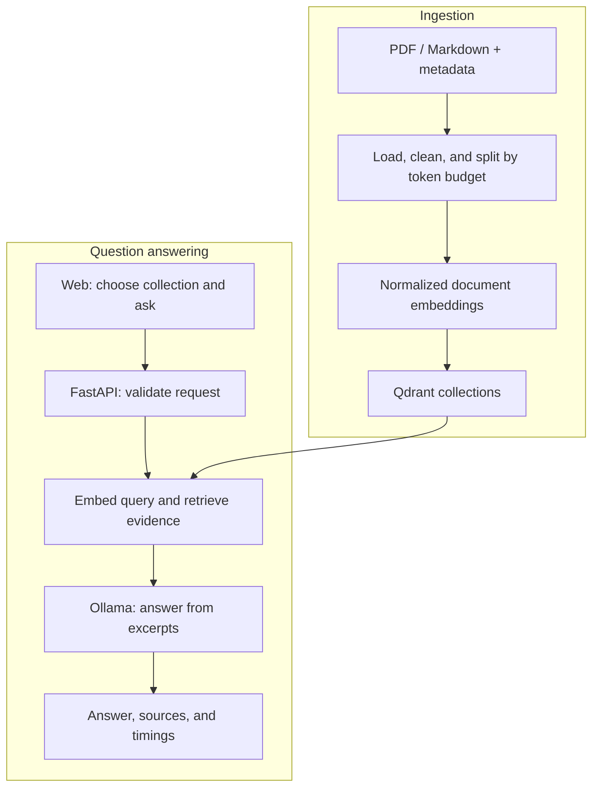

# Enterprise RAG: Local Document Question Answering with Source Citations


> **AI Engineer Portfolio Project**  
> An end-to-end local retrieval-augmented generation application for exploring **NIST Cybersecurity Framework 2.0** and **Kubernetes Deployments** documentation. Implements **PDF and Markdown ingestion**, **token-aware chunking**, **semantic retrieval with Qdrant**, and **source-referenced answers using Ollama**. Includes a **FastAPI backend**, an **English web interface**, and development evaluation of **four local language models** using frozen retrieved evidence.

**Collections:** NIST CSF 2.0 · Kubernetes Deployments  
**Models evaluated:** Phi-4 Mini · Qwen3 · DeepSeek-R1 · Gemma 4  
**Execution:** Local inference without paid inference APIs  
**Status:** Working local demo; assistant-reviewed development metrics available, pending human verification.

## Contents

- [Features](#features)
- [Document collections](#document-collections)
- [Architecture and design choices](#architecture-and-design-choices)
- [Models and configuration](#models-and-configuration)
- [Quality evaluation](#quality-evaluation)
- [Latency measurements](#latency-measurements)
- [Quick start](#quick-start)
- [API usage](#api-usage)
- [Reproducing evaluation](#reproducing-evaluation)
- [Project layout](#project-layout)
- [Troubleshooting](#troubleshooting)
- [Limitations and next steps](#limitations-and-next-steps)
- [Sources and acknowledgements](#sources-and-acknowledgements)

## Features

- English web interface with collection descriptions, topics, boundaries, and example questions.
- Select NIST or Kubernetes for each question; retrieval uses the corresponding Qdrant collection.
- PDF and technical Markdown ingestion, including resolution of selected Hugo shortcodes and local examples.
- Token-aware chunking and normalized document/query embeddings.
- Metadata-filtered retrieval restricted to active content and the configured embedding model.
- Answers with source labels, inspectable excerpts, document versions, and PDF page references where available.
- Separate retrieval and generation timing in API responses and the web interface.
- Comparison of four local models using saved evidence and versioned scoring rubrics.

The application uses pretrained models without fine-tuning. Citation generation is prompt-based; the serving pipeline does not independently verify factual support.

## Document collections

| Collection | Version / source | Domain | Included topics |
|---|---|---|---|
| NIST Cybersecurity Framework | CSF 2.0; NIST CSWP 29, published February 26, 2024 | Cybersecurity governance and risk management | Functions, Categories, Subcategories, Profiles, Tiers, risk communication, and supporting-resource descriptions |
| Kubernetes Deployments | Pinned Kubernetes website snapshot | Container orchestration and application deployment | Creating/updating Deployments, rollout, rollback, scaling, Pod templates, revision history, and cleanup |

The Kubernetes source commit is `e96866675691ab050bc2f5dffc19f21f9fc8c646`. This identifies the documentation snapshot, **not a Kubernetes release version**.

| API dataset value | Qdrant collection |
|---|---|
| `nist` | `nist_csf2_minilm_v1` |
| `kubernetes` | `kubernetes_minilm_v1` |

NIST contains a 32-page PDF. Kubernetes contains the Deployments document and locally resolved supporting examples; it does not cover the entire Kubernetes documentation. Linked external resources are not automatically ingested. Synthetic enterprise documents are used in separate development experiments.

**Language:** The interface and source documents are in English. English questions have been tested. The prompt requests answers in the question's language, but retrieval and answer quality in Vietnamese or other languages have not been evaluated.

## Architecture and design choices



| Choice | Purpose |
|---|---|
| Token-aware chunking | Keep document inputs within the embedding encoder's input limit; the indexer rejects oversized chunks. |
| Same encoder for query and documents | Produce compatible representations for similarity search. |
| 384-dimensional normalized vectors with cosine similarity | Use `sentence-transformers/all-MiniLM-L6-v2` for lightweight local retrieval. |
| Versioned metadata and source references | Trace answers back to document identity, source content, and PDF pages. |
| Shared serving pipeline | Reuse the embedding encoder and select the collection per request. |
| One active generation request | Avoid concurrent requests competing for limited local CPU/RAM; additional requests receive HTTP 503. |
| Frozen evaluation evidence | Compare generation behavior without changing the retrieved excerpts between models within a run. |

The current retriever performs dense vector search. It does not use hybrid search or a cross-encoder reranker.

## Models and configuration

| Ollama tag | Use in this project | Reasoning option | Output token budget |
|---|---|---|---:|
| `phi4-mini:3.8b` | Smaller local comparison model | Not explicitly set | 400 |
| `qwen3:8b` | Model used for the API demo | Disabled | 400 |
| `deepseek-r1:8b` | Comparison with reasoning enabled | Enabled | 1200 |
| `gemma4:12b` | Larger local comparison model | Disabled | 400 |

Recorded generation settings use temperature `0`, context size `4096`, and a client timeout of `600` seconds. Reasoning settings and output budgets differ, so results compare practical configurations rather than models under identical compute budgets.

The serving model is selected at startup through `GENERATION_MODEL`; the web interface currently selects documents, not models. The configuration fallback is Phi-4 Mini unless the environment variable is set. Exact Ollama tags are used; parameter labels alone do not establish model identity, quantization, or memory requirements.

| Environment variable | Default / role |
|---|---|
| `GENERATION_MODEL` | `phi4-mini:3.8b`; set to `qwen3:8b` for this demo |
| `OLLAMA_URL` | `http://localhost:11434` |
| `QDRANT_URL` | `http://localhost:6333` |
| `EMBEDDING_MODEL` | `sentence-transformers/all-MiniLM-L6-v2` |
| `QDRANT_COLLECTION` | `enterprise_docs_minilm_v1`; used by scripts and retrieval without an explicit collection |

Set variables in the terminal that starts the process. The current configuration reads environment variables with `os.getenv`; do not assume a `.env` file is loaded automatically.

## Quality evaluation

**Review status: assistant-reviewed, not yet human-verified.** These are development results, not an independent or held-out benchmark. The questions were used during development and prompt debugging.

- **Kubernetes v1:** six questions/model, frozen top-3 evidence.
- **NIST v2:** six questions/model, frozen top-6 evidence.
- Each dataset has five answerable questions and one unanswerable question.
- Four models produce 48 reviewed answers across the two datasets.
- Evidence and message hashes support consistency checks within each run; prompt versions may differ between datasets.

### Answer quality and citations

| Dataset | Model | Answer accuracy | Required facts | Citation precision | Citation coverage |
|---|---|---:|---:|---:|---:|
| Kubernetes v1 | Phi-4 Mini | 4/6 (66.7%) | 5/8 | 83.3% | 71.4% |
| Kubernetes v1 | Qwen3 | 4/6 (66.7%) | 7/8 | 94.1% | 88.9% |
| Kubernetes v1 | DeepSeek-R1 | 3/6 (50.0%) | 4/8 | 75.0% | 83.3% |
| Kubernetes v1 | Gemma 4 | 5/6 (83.3%) | 7/8 | 100.0% | 100.0% |
| NIST v2 | Phi-4 Mini | 4/6 (66.7%) | 14/16 | 65.0% | 81.2% |
| NIST v2 | Qwen3 | 5/6 (83.3%) | 15/16 | 94.7% | 90.0% |
| NIST v2 | DeepSeek-R1 | 4/6 (66.7%) | 14/16 | 88.5% | 100.0% |
| NIST v2 | Gemma 4 | 5/6 (83.3%) | 15/16 | 92.3% | 95.7% |

All four models correctly refused the single unanswerable question in each dataset: **1/1 per dataset/model**. Phi incorrectly refused one of five answerable questions in each dataset; the other models had **0/5 false refusals** in these runs. One refusal example per dataset is insufficient to establish general refusal reliability.

### Metric definitions

| Metric | Definition |
|---|---|
| Answer accuracy | Completed run, all required facts present, no unsupported claims, and no false/mixed refusal. Unanswerable questions require a correct refusal without factual answer claims. |
| Required-fact coverage | Correct binary required facts divided by all required facts, micro-averaged within a dataset/model. |
| Citation precision | Supported atomic claim–source links divided by all annotated links. |
| Citation coverage | Factual claim occurrences fully supported by at least one attached citation divided by all factual claim occurrences. |
| Correct refusal rate | Correct refusals divided by unanswerable questions. |
| False refusal rate | Incorrect/mixed refusals divided by answerable questions. |
| Format compliance | Compliance with source-label and code-block conventions, citation placement, and absence of response-mode labels. Reported separately in the full metrics. |

Citation precision and coverage are different. A claim can have one supporting citation plus redundant unsupported citations: coverage passes while precision decreases. Citation coverage does not measure omitted required facts. Refusal-only outputs add no claims to citation denominators; a zero denominator is reported as N/A.

Claims are split into semantic units, including command instructions; repeated assertions count as separate occurrences. Citation attachment and claim splitting affect the results. Review rules are recorded alongside the annotations.

**Strict rubric decisions:**

- NIST-Q04 requires both non-prescriptive scope and guidance on practices/controls. A generic mention of online resources alone does not satisfy the second required fact.
- Kubernetes-Q04 requires the qualification that **only** the Pod template is restored.
- Kubernetes-Q05 is rescored with zero-replica and complete-state cleanup conditions added to the original reference answer. This is a rubric correction, not a new model run.

Each question contributes 16.7 percentage points to answer accuracy. Fact counts vary by question, so micro-averaged fact coverage is not an equal-weight question average. No broad model ranking or production-quality claim is implied.

**Not measured:** Retrieval Recall@k, Precision@k, MRR, and NDCG require relevance labels that have not been completed. Peak memory, a multilingual benchmark, and serving-load benchmarks have not been measured.

### Evaluation artifacts

- [Full benchmark](evaluation/reports/assistant_v1/benchmark.md)
- [Machine-readable metrics](evaluation/reports/assistant_v1/metrics.json)
- [Detailed assistant annotations](evaluation/scores/manual_reviews_assistant_v1.json)
- [NIST rubric](evaluation/rubrics/nist_dev_rubric_v1.json)
- [Kubernetes rubric](evaluation/rubrics/kubernetes_dev_rubric_v1.json)
- [NIST questions](evaluation/datasets/nist_dev.json) and [frozen v2 evidence](evaluation/datasets/nist_dev_evidence_v2.jsonl)
- [Kubernetes questions](evaluation/datasets/kubernetes_dev.json) and [frozen v1 evidence](evaluation/datasets/kubernetes_dev_evidence_v1.jsonl)

The annotation file preserves the reviewed answers and points to the original JSONL result filenames. Original local run outputs reside under `evaluation/results/`; their availability in a clone depends on whether those files have been committed. Human review of annotations is pending.

## Latency measurements

Measured on Windows with 15.7 GB RAM and CPU inference. Each entry represents six model calls.

| Model | Kubernetes mean/call | Kubernetes total | NIST mean/call | NIST total |
|---|---:|---:|---:|---:|
| Phi-4 Mini | 35.23 s | 3.52 min | 87.72 s | 8.77 min |
| Qwen3 | 86.82 s | 8.68 min | 191.38 s | 19.14 min |
| DeepSeek-R1 | 175.59 s | 17.56 min | 290.17 s | 29.02 min |
| Gemma 4 | 244.44 s | 24.44 min | 399.30 s | 39.93 min |

Total recorded model-call time: approximately **0.90 hours for Kubernetes v1**, **1.61 hours for NIST v2**, and **2.51 hours combined**.

These measurements include prompt processing, output generation, and model loading when it occurs during a call. They exclude model downloads, document indexing, retrieval performed while preparing frozen evidence, and other experiments. They are not complete API end-to-end response times or the total time spent developing the project.

Different retrieval sizes, possible prompt changes, reasoning options, and model budgets prevent attributing cross-dataset latency differences solely to document difficulty. Cold and warm calls are not separated in the aggregate. No latency SLA is claimed.

## Quick start

### 1. Prerequisites

- Git, Docker Desktop with a running Linux container engine, and Ollama.
- Python 3.13 was used in development; other versions have not been validated here.
- Sufficient RAM and disk space for the selected model, Python dependencies, embeddings, and vector storage. The reference machine has approximately 16 GB RAM and uses one generation model at a time.
- Internet access for the initial package/image/model downloads. Inference uses local services; source-document links and badge images require internet access when opened.

### 2. Clone and install dependencies

```powershell
git clone https://github.com/JustKha05/enterprise-rag-local.git
cd enterprise-rag-local

python -m venv .venv
.\.venv\Scripts\python.exe -m pip install -r requirements.txt
```

The commands below use the virtual environment's Python directly; activation is optional.

### 3. Start local services

Start Docker Desktop and Ollama, then run:

```powershell
docker compose up -d
ollama pull qwen3:8b

$env:GENERATION_MODEL = "qwen3:8b"
.\.venv\Scripts\python.exe -m scripts.check_services
```

Only the selected generation model is needed for the demo. Download the other models if you want to repeat the comparison.

### 4. Index the document collections

The source documents, metadata, and supporting Kubernetes files must exist under `data/raw/`. Document loaders verify source hashes against metadata.

```powershell
$env:QDRANT_COLLECTION = "nist_csf2_minilm_v1"
.\.venv\Scripts\python.exe -m scripts.index_nist

$env:QDRANT_COLLECTION = "kubernetes_minilm_v1"
.\.venv\Scripts\python.exe -m scripts.index_kubernetes
```

A source checkout does not contain your existing Qdrant database. Index the documents when setting up a fresh database. Reindexing is not required before every web session. If source content or chunking changes, use a separately versioned collection or an explicit cleanup procedure; upserts alone do not guarantee stale points are removed.

### 5. Start the application

```powershell
$env:GENERATION_MODEL = "qwen3:8b"

.\.venv\Scripts\python.exe -m uvicorn app.api.main:app --host 127.0.0.1 --port 8000
```

- Web: [http://127.0.0.1:8000](http://127.0.0.1:8000)
- Interactive API documentation: [http://127.0.0.1:8000/docs](http://127.0.0.1:8000/docs)

Keep the terminal open; press Ctrl+C to stop the server. Restart after changing Python code or environment variables. Open the interface through the server URL rather than opening `index.html` directly.

### 6. Use the web interface

1. Select a document collection and read its scope.
2. Enter a question or select an example.
3. Wait for local processing; CPU inference can take several minutes.
4. Inspect the answer and expand its cited source excerpts.

Example NIST question: `Should CSF Tiers replace an organization's cybersecurity risk management methodology?`

Example Kubernetes question: `How do I roll back nginx-deployment to revision 2?`

The model selection remains fixed for the running server. Collection selection applies to each individual question.

## API usage

| Endpoint | Purpose |
|---|---|
| `GET /` | Serve the English web interface. |
| `GET /health` | Report application status, configured model, and available dataset mappings. This is not a live dependency-readiness check. |
| `POST /ask` | Answer a question using the selected document collection. |

Example request:

```json
{
  "query": "How do I roll back nginx-deployment to revision 2?",
  "dataset": "kubernetes",
  "top_k": 6
}
```

Send it from another PowerShell terminal:

```powershell
$body = @{
    query = "How do I roll back nginx-deployment to revision 2?"
    dataset = "kubernetes"
    top_k = 6
} | ConvertTo-Json

Invoke-RestMethod -Uri "http://127.0.0.1:8000/ask" -Method Post -ContentType "application/json" -Body $body
```

The response contains `query`, `dataset`, `model`, `collection`, `answer`, `sources`, `retrieval_seconds`, `generation_seconds`, and `done_reason`. Sources include labels, document identity/version, excerpts, scores, and optional URLs/PDF pages. Retrieval scores are similarity scores, not confidence probabilities.

The API accepts `nist` or `kubernetes`, `top_k` from 1 to 6, and nonblank questions up to 2,000 characters. The embedding encoder also imposes a token limit. Invalid request fields receive validation errors; a busy generation pipeline returns HTTP 503. Internal processing failures return HTTP 500 with details in server logs.

The server is bound to loopback. Public hosting and authentication are not configured.

## Reproducing evaluation

### Recalculate metrics from existing annotations

This does not invoke Ollama:

```powershell
.\.venv\Scripts\python.exe -m scripts.summarize_manual_scores
```

The default input is `evaluation/scores/manual_reviews_assistant_v1.json`. Reports are written to `evaluation/reports/assistant_v1/`. Existing reports are preserved; if they already exist, choose a new directory:

```powershell
.\.venv\Scripts\python.exe -m scripts.summarize_manual_scores --output-dir evaluation/reports/assistant_v1_recomputed
```

The script aggregates explicit annotations and checks incomplete reviews, duplicate entries, and score consistency. It does not judge semantic correctness automatically. Verify the annotations before presenting them as human-reviewed results.

### Create a new generation run

For an existing frozen evidence file:

```powershell
.\.venv\Scripts\python.exe -m scripts.run_evaluation --model qwen3:8b --evidence nist_dev_evidence_v2.jsonl --output qwen3_nist_dev_run3.jsonl
```

Use a new output filename and keep earlier runs. A new result file requires a new review; existing scores do not automatically apply to changed answers.

To generate a new evidence snapshot, first select the correct indexed collection:

```powershell
$env:QDRANT_COLLECTION = "nist_csf2_minilm_v1"
.\.venv\Scripts\python.exe -m scripts.prepare_evaluation --dataset nist_dev.json --output nist_dev_evidence_v3.jsonl --top-k 6
```

Use the same frozen evidence for every model in a comparison. Record the prompt, evidence hashes, model options, and source snapshot. Changing retrieval settings or prompts creates a new experimental configuration.

## Project layout

| Path | Responsibility |
|---|---|
| `app/config.py` | Environment-based service and model configuration |
| `app/ingestion/` | Loading, cleaning, chunking, embedding, and indexing |
| `app/retrieval/retriever.py` | Query embedding and filtered Qdrant search |
| `app/rag/pipeline.py` | Retrieval and local generation orchestration |
| `app/rag/prompts.py` | Shared system prompt and evidence formatting |
| `app/api/main.py` | FastAPI endpoints and request serialization |
| `app/web/index.html` | English document question-answering interface |
| `data/raw/` | Source documents, metadata, and supporting examples |
| `scripts/` | Service checks, ingestion inspection, indexing, and evaluation tools |
| `evaluation/datasets/` | Questions and frozen retrieved evidence |
| `evaluation/results/` | Local generation-run JSONL outputs |
| `evaluation/rubrics/` | Versioned reference facts and scoring criteria |
| `evaluation/scores/` | Detailed review annotations |
| `evaluation/reports/` | Generated benchmark tables and metrics |

## Troubleshooting

| Symptom | Action |
|---|---|
| `ollama` is not recognized | Confirm Ollama installation and reopen the terminal so PATH changes take effect. |
| Qdrant connection fails | Start Docker Desktop, run `docker compose up -d`, and inspect `docker compose ps`. |
| Selected collection is missing or empty | Index the corresponding dataset using its documented collection name. |
| An embedding input-limit error occurs | Shorten the question or adjust token-aware chunking for oversized document chunks. |
| Source hash mismatch | Check the raw snapshot against its metadata; avoid silently accepting altered source content. |
| HTTP 503 from `/ask` | Another question is active. Retry after it completes. |
| Updated HTML is not visible | Refresh the server URL with Ctrl+F5. |
| Python changes do not take effect | Restart Uvicorn; the documented command does not enable automatic reload. |
| Metrics input is missing | Copy the reviewed annotation JSON into `evaluation/scores/`; do not substitute the pending template. |
| Metric reports already exist | Pass a new `--output-dir` rather than overwriting the earlier report. |

## Limitations and next steps

### Current limitations

- CPU response times can be several minutes; no serving-load benchmark or latency guarantee.
- One active generation request per server process; multiple workers would duplicate resources and are not part of the tested setup.
- Source citations can be incorrect, incomplete, or poorly formatted.
- Each question is independent; there is no conversational memory.
- No document upload, cross-collection query, reranker, answer cache, or token streaming.
- No private organizational data or live Kubernetes cluster access.
- Multilingual retrieval and out-of-domain behavior have not been systematically evaluated.
- Small development datasets and assistant review limit the conclusions drawn from the metrics.
- The current application is a local demonstration, not a production deployment.

### Planned improvements

- Human verification of current annotations and a larger held-out evaluation set.
- Evidence relevance labels and retrieval ranking metrics.
- Evaluation of multilingual embeddings and questions.
- Response caching and streaming for a more responsive interface.
- Fresh-clone installation validation, release packaging, screenshots, and a recorded walkthrough.

Screenshots and a demo video are not included in this README yet. Add captures from the working application after validating both document collections; if video waiting periods are shortened, disclose that editing.

## Sources and acknowledgements

### Documents

- **NIST CSF 2.0:** National Institute of Standards and Technology, February 26, 2024. [Publication DOI](https://doi.org/10.6028/NIST.CSWP.29) · [Source PDF](https://nvlpubs.nist.gov/nistpubs/CSWP/NIST.CSWP.29.pdf).
- **Kubernetes Deployments:** Official documentation pinned to commit `e96866675691ab050bc2f5dffc19f21f9fc8c646`. [Source snapshot](https://github.com/kubernetes/website/blob/e96866675691ab050bc2f5dffc19f21f9fc8c646/content/en/docs/concepts/workloads/controllers/deployment.md).
- **Synthetic documents:** Created for development testing; they do not represent actual organizational policies.

### Models and software

- Embedding: [sentence-transformers/all-MiniLM-L6-v2](https://huggingface.co/sentence-transformers/all-MiniLM-L6-v2).
- Generation runtime: [Ollama](https://github.com/ollama/ollama). Exact model tags and recorded options are listed above.
- Retrieval storage: [Qdrant](https://github.com/qdrant/qdrant).
- Pipeline components: [LangChain](https://github.com/langchain-ai/langchain).
- API framework: [FastAPI](https://github.com/fastapi/fastapi).

Third-party documents, software, and model weights retain their respective licenses and terms. Refer to their source repositories and model cards; this README does not assign a common license to them. No license for this project's own code is declared here—consult the repository's `LICENSE` file if one is added.

**Author:** Nguyen Hoang Kha · [GitHub](https://github.com/JustKha05)  
**Repository:** [enterprise-rag-local](https://github.com/JustKha05/enterprise-rag-local)
